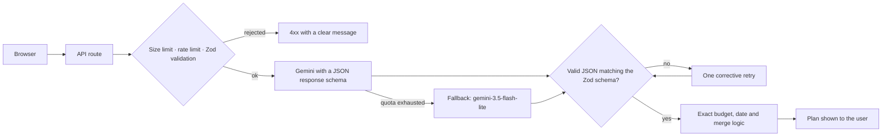

# Utsava — AI Celebration & Event Planner

> **PromptWars Virtual 2026 · Challenge 5 — Celebration & Event Planner**
> _"Create a GenAI-powered planning assistant that helps users organize weddings, birthdays, and community events with budgets, timelines, vendor checklists, and personalized ideas."_

Utsava turns a few details about your celebration (type, date, city, guests, budget, traditions) into a complete plan generated by **Google Gemini**: theme, activities, budget split, preparation timeline, vendor checklist and ideas. Everything that must be exact (rupee amounts, due dates, merges) is calculated by tested TypeScript, not by the AI.

**Built with:** Next.js 16 (App Router) · React 19 · TypeScript (strict) · Tailwind CSS v4 · Google Gemini (`@google/genai`) · Zod · Vitest · Playwright

---

## Features

| Requirement | What Utsava does |
| --- | --- |
| **Weddings, birthdays, community events** | A three-step wizard captures event type, date, city, guests and budget, plus Indian wedding sub-events (Haldi, Mehendi, Sangeet, Pheras, Reception), dietary needs, cultural traditions and accessibility needs. |
| **AI-generated plan** | Gemini returns a structured blueprint: theme and decor, activities, budget allocation, timeline, vendor categories, risks, missing information and eco-friendly / budget / accessible alternatives. |
| **Budgets** | AI percentages are normalised to exactly 100% and converted to whole rupees that add up to your total. Track expenses, get overspend alerts per category, and edit the total budget at any time. |
| **Timelines** | Milestones are stored as "days before the event", so changing the event date shifts every due date automatically. Filter by status and priority; overdue tasks are highlighted. |
| **Vendor checklists** | AI suggests vendor categories and questions to ask — never real business names or phone numbers. Record your own vendors and quotes and compare them with the category budget. |
| **Personalised ideas** | Idea Studio generates ideas for theme, food, activities, decor and return gifts, which can be added straight to the timeline. |
| **Refine in plain language** | Ask for changes such as "cut the total budget by 20%" or "make it eco-friendly". Only the affected sections change; your expenses, completed tasks and vendor details are kept. |
| **Export** | Download the budget, timeline and vendors as CSV, or print a coordinator checklist. |

All plans are saved in your browser, so they survive page refreshes.

---

## How the AI is used

All Gemini calls happen on the server (`src/app/api/*`); the API key never reaches the browser.



- **Structured output:** response schemas are generated from the Zod schemas, and every answer is validated before use.
- **Resilience:** 45-second timeout, retry on temporary 503 errors, one retry without the schema if Gemini rejects it, and a fallback model when the daily quota runs out.
- **Refinements must change something:** Gemini lists the sections it changed; if nothing changed, the user is told instead of seeing a fake success.
- **Prompt safety:** user text is wrapped in `<user_input>` tags and treated as data, not instructions.

| Endpoint | Purpose |
| --- | --- |
| `POST /api/generate-blueprint` | Create the full celebration plan |
| `POST /api/refine-plan` | Apply a natural-language change to the plan |
| `POST /api/generate-ideas` | Generate ideas for one Idea Studio section |

---

## Project structure

```
src/
├── app/
│   ├── api/                 # Gemini endpoints (server-only)
│   ├── events/[id]/         # Planner workspace for one event
│   ├── new/                 # Event creation wizard
│   └── page.tsx             # Landing page and saved events
├── components/
│   ├── landing/             # Hero, categories, features, saved events
│   ├── wizard/              # Wizard steps and live preview
│   ├── planner/             # Planner tabs (dashboard, budget, timeline, vendors,
│   │                        #   ideas, refine, export) and their sub-components
│   └── ui/                  # Accessible building blocks (Button, Input, Modal, …)
├── lib/
│   ├── ai/                  # Gemini client, prompts, refinement merge
│   ├── budget.ts            # Budget maths and vendor merging
│   ├── dates.ts             # IST dates, due dates, task merging
│   ├── storage.ts           # Validated localStorage persistence
│   ├── csv.ts               # Safe CSV export
│   ├── api.ts               # Typed browser → API client
│   └── rateLimit.ts …       # Rate limiting and helpers
└── schemas/                 # Zod schemas: the single source of truth for types
```

---

## Security

- `GEMINI_API_KEY` is read only on the server; errors from Gemini are logged on the server and users see a generic message.
- Every AI endpoint has a 64 KB request limit, per-client and global rate limits, and Zod validation (including rejecting past event dates).
- AI output is rendered as plain text — never as HTML. Data loaded from `localStorage` is validated again with Zod.
- CSV exports neutralise spreadsheet formulas (`=`, `+`, `-`, `@`).
- Security headers in `next.config.ts`: Content-Security-Policy, Strict-Transport-Security, X-Frame-Options, X-Content-Type-Options, Referrer-Policy and Permissions-Policy; `X-Powered-By` is disabled.

## Accessibility

- Keyboard-friendly throughout: tabs use arrow keys, dialogs trap focus, close on Escape and return focus.
- Every form field has a label; errors are announced to screen readers.
- Light and dark themes, respects "reduce motion", and works down to 360px-wide screens.
- Checked with `@axe-core/playwright` in both themes.

---

## Getting started

Requires **Node.js 20.19 or newer**.

```bash
git clone https://github.com/SVG700/Utsava.git
cd Utsava
npm ci
cp .env.example .env.local
```

Add your Gemini API key ([get one free](https://aistudio.google.com/apikey)) to `.env.local`:

```env
GEMINI_API_KEY=your_api_key_here
GEMINI_MODEL=gemini-3.5-flash
```

Then start the app at http://localhost:3000:

```bash
npm run dev
```

### Commands

| Command | What it does |
| --- | --- |
| `npm run dev` | Start the development server |
| `npm run build` · `npm start` | Build and serve the production app |
| `npm run lint` · `npm run typecheck` | Static checks |
| `npm test` | Unit and component tests |
| `npx vitest run --coverage` | Tests with a coverage report |
| `npm run test:e2e` | End-to-end tests (Gemini is mocked) |
| `node scripts/smoke-live.mjs` | Live check against real Gemini (run while `npm start` is running) |

---

## Testing

- **183 unit and component tests** (Vitest, 15 files): budget maths, dates, merging, schemas, storage, CSV export, the Gemini client (retries, fallback, timeouts, safe errors), API routes, rate limiting, and the Modal, Budget, Ideas and Refine components.
- **7 end-to-end tests** (Playwright): full planning flow with reload, mobile refinement, regenerating while keeping your data, keyboard-only use, 360px layout, accessibility audit in light and dark mode, and theme persistence.
- **Live smoke test:** checks real Gemini output, e.g. that "cut the total budget by 20%" returns exactly 80% of the original budget.

## Known limitations

- **Gemini free tier:** daily limits apply. The app falls back to a lighter model and shows a clear message if both are unavailable.
- **Rate limiting is in memory:** it resets when the server restarts; a multi-server deployment would need a shared store such as Redis.
- **Data stays on one device:** plans are stored in the browser and are not synced between devices.
