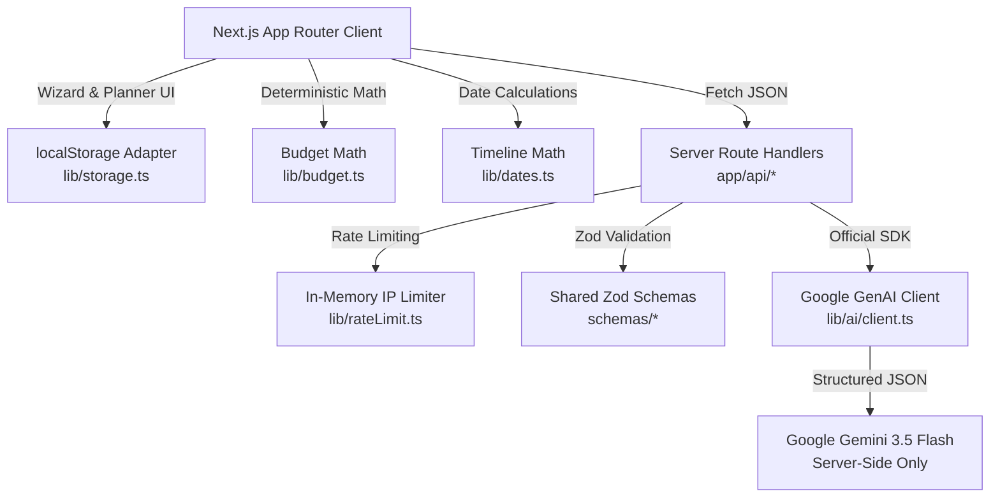

# Utsava — Your AI Celebration Planner

> **PromptWars Virtual 2026 — Challenge 5: "Celebration & Event Planner"**  
> *Official Problem Statement:* "Create a GenAI-powered planning assistant that helps users organize weddings, birthdays, and community events with budgets, timelines, vendor checklists, and personalized ideas."

Built with **Next.js 16 (App Router)**, **TypeScript (Strict Mode)**, **Tailwind CSS v4**, **Google Gemini via the official `@google/genai` SDK**, **Zod**, and **Vitest**.

---

## 🌟 Overview & Indian Celebration Context

In India, celebrations are multi-day, culturally rich, and logistically complex:
- **Weddings** span multiple ceremonies (Haldi, Mehendi, Sangeet, Pheras/Mandap, Reception) with family traditions (Marwari, Punjabi, South Indian, Bengali, etc.).
- **Birthdays** range from 1st birthdays and kid theme parties to 50th/60th Golden Jubilee milestones.
- **Community Events** include festive celebrations (Ganesh Chaturthi, Diwali Mela, Navratri Dandiya), residential society gatherings, and college festivals.

**Utsava** provides a planning assistant that pairs **Google Gemini generative intelligence** with **deterministic, penny-perfect Indian financial arithmetic** (`₹` in `en-IN` grouping, e.g. `₹15,00,000`).

---

## 🎯 How Each Feature Maps to the Problem Statement

| # | Problem Statement Requirement | Utsava Feature Implementation | Source Files |
|---|-------------------------------|-------------------------------|--------------|
| **1** | **Organize Weddings, Birthdays, Community Events** | Multi-step Event Wizard with Indian sub-event selection (Haldi, Mehendi, Sangeet, Wedding, Reception), city chips (Mumbai, Jaipur, Bengaluru, etc.), guest count scaling, and INR budget entry. Validated with Zod schemas. | [`src/components/EventWizard.tsx`](src/components/EventWizard.tsx), [`src/schemas/event.ts`](src/schemas/event.ts) |
| **2** | **GenAI Event Blueprint** | Server-side Gemini route returning structured JSON conforming to `aiBlueprintSchema`: themes, guest-scaled activities, budget allocations, preparation timeline, vendor categories, risks/assumptions, and eco-friendly/budget alternatives. Retry logic on schema failure. | [`src/app/api/generate-blueprint/route.ts`](src/app/api/generate-blueprint/route.ts), [`src/lib/ai/client.ts`](src/lib/ai/client.ts) |
| **3** | **Budgets with Deterministic Math** | All arithmetic is pure TypeScript in `lib/budget.ts`. AI percentages are normalised to 100% and converted to exact rupee figures. Expense ledger with add/edit/delete, category-level and overall overspend alerts. AI numbers are never blindly trusted. | [`src/lib/budget.ts`](src/lib/budget.ts), [`src/components/planner/BudgetTab.tsx`](src/components/planner/BudgetTab.tsx) |
| **4** | **Smart Timeline with Deadlines** | Preparation tasks with due dates computed relative to the celebration date via `lib/dates.ts`. Priority badges, completion toggles, overdue warnings in rose, and automatic date recalculation when event date changes. | [`src/lib/dates.ts`](src/lib/dates.ts), [`src/components/planner/TimelineTab.tsx`](src/components/planner/TimelineTab.tsx) |
| **5** | **Vendor Checklists & Quote Comparison** | Vendor categories with AI-suggested interview questions. Strict privacy: AI never invents fake business names or phone numbers. User records real vendor quotes compared against category budget targets. | [`src/components/planner/VendorsTab.tsx`](src/components/planner/VendorsTab.tsx), [`src/schemas/plan.ts`](src/schemas/plan.ts) |
| **6** | **Personalized Ideas (Idea Studio)** | On-demand generation for specific sections: Theme, Food & Live Stalls, Activities, Decor, and Return Gifts. Direct "+ Add to Timeline" action. | [`src/app/api/generate-ideas/route.ts`](src/app/api/generate-ideas/route.ts), [`src/components/planner/IdeasTab.tsx`](src/components/planner/IdeasTab.tsx) |
| **7** | **AI Plan Refinement** | Conversational refinement chat ("cut budget by 20%", "make decor 100% eco-friendly"). Gemini returns only changed sections; deterministic merge updates the plan without altering unrelated sections or user data. | [`src/app/api/refine-plan/route.ts`](src/app/api/refine-plan/route.ts), [`src/lib/ai/mergePlan.ts`](src/lib/ai/mergePlan.ts), [`src/components/planner/RefineTab.tsx`](src/components/planner/RefineTab.tsx) |
| **8** | **Comprehensive Dashboard** | Real-time celebration countdown, budget utilisation progress, task completion metrics, vendor readiness breakdown, upcoming deadlines, and contingency assumptions. Nothing hard-coded. | [`src/components/planner/DashboardTab.tsx`](src/components/planner/DashboardTab.tsx) |
| **9** | **Multi-Event Persistence** | Multiple celebrations saved in localStorage behind a clean storage adapter (`lib/storage.ts`). Survives page refreshes. Preset templates for instant start. | [`src/lib/storage.ts`](src/lib/storage.ts), [`src/app/page.tsx`](src/app/page.tsx) |
| **10** | **Export & Print** | Print-friendly coordinator checklist view (`window.print()`) and one-click CSV downloads for Budget, Timeline Tasks, and Vendor Contacts. | [`src/components/planner/ExportTab.tsx`](src/components/planner/ExportTab.tsx) |

---

## 🏛️ System Architecture



### Directory Structure

```
src/
├── app/
│   ├── api/
│   │   ├── generate-blueprint/route.ts  # Gemini blueprint generation
│   │   ├── generate-ideas/route.ts      # Idea Studio generation
│   │   └── refine-plan/route.ts         # Targeted plan refinement
│   ├── events/[id]/page.tsx             # Celebration dashboard & workspace
│   ├── new/page.tsx                     # Event creation wizard page
│   ├── globals.css                      # Festive Tailwind v4 theme & print styles
│   ├── layout.tsx                       # Root layout with navbar & metadata
│   └── page.tsx                         # Celebration list & template presets
├── components/
│   ├── Navbar.tsx                       # Top navigation with dark/light mode
│   ├── EventWizard.tsx                  # 3-step creation wizard with Zod validation
│   ├── planner/
│   │   ├── MainPlanner.tsx              # Coordinator component & tab controller
│   │   ├── PlannerHeader.tsx            # Celebration header, countdown & date editor
│   │   ├── DashboardTab.tsx             # Overview stats, milestones & alternatives
│   │   ├── BudgetTab.tsx                # Category allocations, expense tracker
│   │   ├── TimelineTab.tsx              # Dynamic timeline & priority filters
│   │   ├── VendorsTab.tsx               # Vendor quotes, checklist & interview tips
│   │   ├── IdeasTab.tsx                 # Idea Studio by section
│   │   ├── RefineTab.tsx                # Conversational AI refinement
│   │   └── ExportTab.tsx                # Print view & CSV download
│   └── ui/                              # Accessible UI primitives (Button, Card, Modal, etc.)
├── lib/
│   ├── ai/
│   │   ├── client.ts                    # Official @google/genai SDK wrapper
│   │   ├── mergePlan.ts                 # Deterministic plan refinement merge
│   │   └── prompts.ts                   # Culturally aware prompts & safety rules
│   ├── budget.ts                        # Pure arithmetic, normalisation, INR format
│   ├── dates.ts                         # Pure date calculations & auto-recalculation
│   ├── rateLimit.ts                     # In-memory sliding-window IP rate limiter
│   └── storage.ts                       # Pluggable persistence layer
└── schemas/                             # Shared Zod schemas (Single source of truth)
    ├── ai.ts                            # AI request/response validation schemas
    ├── event.ts                         # Event input & stored event schemas
    ├── plan.ts                          # Budget, Expense, Task, Vendor schemas
    └── index.ts                         # Barrel exports
```

---

## 🤖 GenAI Integration & Prompt Engineering

1. **Official SDK Only:** Calls use `@google/genai` exclusively on the server side (`src/lib/ai/client.ts`). The API key is never bundled, passed to the browser, or logged.
2. **Model Selection:** Default is `gemini-3.5-flash` (configurable via `GEMINI_MODEL` environment variable).
3. **Structured Outputs:** Requests specify `responseMimeType: 'application/json'` and are validated against rigorous Zod schemas.
4. **Retry & Recovery:** If model response fails JSON parsing or schema validation, a corrective prompt is dispatched automatically once before presenting a user-friendly error.
5. **Vendor Safety Boundary:** Strict prompt instructions forbid generating fictitious business names, phone numbers, or fake reviews. AI output is clearly tagged as *"AI Suggestions & Guidelines"* while user data is marked as *"User Data"*.
6. **Graceful Degradation:** If `GEMINI_API_KEY` is unset or placeholder, the application surfaces a setup banner with AI Studio link rather than crashing.

---

## 🔒 Security & Efficiency

- **Server-Only Secrets:** `GEMINI_API_KEY` is loaded strictly in server route handlers.
- **Input Sanitization:** All incoming API payloads are length-limited and validated with Zod.
- **In-Memory Rate Limiting:** Sliding-window rate limiter per client IP (`lib/rateLimit.ts`) protects AI endpoints from runaway usage.
- **Security Headers:** Configured in `next.config.ts` (`Strict-Transport-Security`, `X-Content-Type-Options: nosniff`, `X-Frame-Options: DENY`, `X-XSS-Protection`, `Referrer-Policy`, `Permissions-Policy`).
- **XSS Prevention:** AI text is rendered via React text nodes (no `dangerouslySetInnerHTML`).
- **Lightweight Footprint:** The entire repository source is **under 1 MB** (well below the 10 MB limit).

---

## ♿ Accessibility & UX Polish

- **WCAG AA Contrast:** Tested colors with high-contrast text ratios in light and dark mode.
- **Keyboard Navigation:** Full tab order, escape keys for modals, and visible focus rings (`focus-visible:ring-2 ring-amber-500`).
- **Motion Sensitivity:** Respects `prefers-reduced-motion: reduce` by disabling non-essential animations.
- **Semantic HTML:** Labels on all inputs, `aria-invalid`, `aria-describedby` for inline validation errors, and `role="dialog"` for modals.
- **Print Optimization:** Clean media print stylesheet hides navigation and action buttons, styling a presentation checklist for event day coordinators.

---

## 🚀 Getting Started

### 1. Prerequisites
- Node.js 20+ (tested on Node v22.12.0)
- npm 10+

### 2. Installation
```bash
git clone <repo-url>
cd utsava
npm install --legacy-peer-deps
```

### 3. Environment Configuration
Copy the example environment file:
```bash
cp .env.example .env.local
```
Edit `.env.local` with your Google Gemini API key:
```env
GEMINI_API_KEY=your_actual_gemini_api_key_here
GEMINI_MODEL=gemini-3.5-flash
```
*(Get a free key at [Google AI Studio](https://aistudio.google.com/apikey))*

### 4. Run Development Server
```bash
npm run dev
```
Open [http://localhost:3000](http://localhost:3000) in your browser.

---

## 🧪 Testing Suite

### Unit Tests (Vitest)
Comprehensive unit tests cover budget normalisation, INR currency formatting, date offsets, Zod schema validation, plan refinement merging, rate limiting, and storage persistence:
```bash
npm test
```
*Result: 83 tests passing across 7 test suites.*

### End-to-End Tests (Playwright)
Validates the complete user workflow across viewports:
1. **Desktop Happy-Path:** Create event → generate plan (hermetic mock) → record expense → toggle task complete → page refresh → verify localStorage persistence.
2. **Mobile Responsive Viewport:** Mobile creation wizard → tab navigation → conversational AI plan refinement → live UI updates.
```bash
npm run test:e2e
```

### Type Checking & Linting
```bash
npm run typecheck
npm run lint
```

### Production Build
```bash
npm run build
```

---

## 📦 Deployment (Vercel / Cloud)

This project is a standard Next.js App Router application ready for zero-configuration deployment on Vercel:
1. Push code to your Git repository.
2. Import project on [Vercel](https://vercel.com).
3. Set the Environment Variable:
   - `GEMINI_API_KEY`: Your Google Gemini API key
   - `GEMINI_MODEL`: `gemini-3.5-flash` (optional, defaults to `gemini-3.5-flash`)
4. Deploy!
