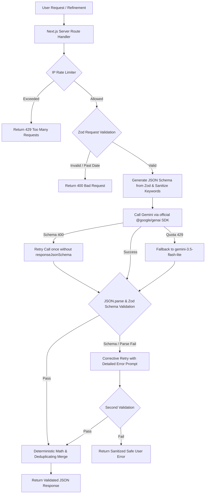

# Utsava — Your AI Celebration Planner

> **PromptWars Virtual 2026 — Challenge 5: "Celebration & Event Planner"**  
> *Official Problem Statement:* "Create a GenAI-powered planning assistant that helps users organize weddings, birthdays, and community events with budgets, timelines, vendor checklists, and personalized ideas."

Built with **Next.js 16 (App Router)**, **TypeScript (Strict Mode)**, **Tailwind CSS v4**, **Google Gemini via the official `@google/genai` SDK**, **Zod**, **Vitest**, and **Playwright**.

---

## 🌟 Overview & Indian Celebration Context

In India, celebrations are multi-day, culturally rich, and logistically intricate:
- **Weddings** span multiple ceremonies (Haldi, Mehendi, Sangeet, Pheras/Mandap, Reception) across regional traditions (Marwari, Punjabi, South Indian, Bengali, etc.).
- **Birthdays** span 1st birthdays, themed kids parties, and 50th/60th Golden Jubilee milestones.
- **Community Events** include festive gatherings (Ganesh Chaturthi, Diwali Mela, Navratri Dandiya), residential society events, and college festivals.

**Utsava** provides a specialized planning assistant that pairs **Google Gemini generative intelligence** with **deterministic Indian financial arithmetic** (`₹` in `en-IN` numbering format, e.g. `₹15,00,000`).

---

## 🎯 How Each Feature Maps to the Problem Statement

| # | Problem Statement Requirement | Utsava Feature Implementation | Source Files |
|---|-------------------------------|-------------------------------|--------------|
| **1** | **Organize Weddings, Birthdays, Community Events** | Multi-step Event Wizard with Indian sub-event selection (Haldi, Mehendi, Sangeet, Wedding, Reception), tier chips, guest count scaling, and INR budget entry. Validated with Zod schemas. | [`src/components/EventWizard.tsx`](src/components/EventWizard.tsx), [`src/components/wizard/*`](src/components/wizard/), [`src/schemas/event.ts`](src/schemas/event.ts) |
| **2** | **GenAI Event Blueprint** | Server-side Gemini route returning structured JSON conforming to `aiBlueprintSchema`: themes, guest-scaled activities, budget allocations, preparation timeline, vendor categories, risks/assumptions, and eco-friendly/budget alternatives. | [`src/app/api/generate-blueprint/route.ts`](src/app/api/generate-blueprint/route.ts), [`src/lib/ai/client.ts`](src/lib/ai/client.ts) |
| **3** | **Budgets with Deterministic Math** | Pure TypeScript in `lib/budget.ts`. AI percentages are normalised to 100% and converted to exact rupee figures. Total budget editing control with instant category recalculation. Expense ledger with category overspend warnings. | [`src/lib/budget.ts`](src/lib/budget.ts), [`src/components/planner/BudgetTab.tsx`](src/components/planner/BudgetTab.tsx) |
| **4** | **Smart Timeline with Deadlines** | Preparation tasks with due dates computed relative to the celebration date via `lib/dates.ts`. Priority badges, completion toggles, overdue warnings in rose, and automatic date recalculation when event date changes. | [`src/lib/dates.ts`](src/lib/dates.ts), [`src/components/planner/TimelineTab.tsx`](src/components/planner/TimelineTab.tsx) |
| **5** | **Vendor Checklists & Quotes** | Vendor categories with AI-suggested interview questions. Strict privacy: AI never invents fake business names or phone numbers. User records real vendor quotes compared against category budget targets. | [`src/components/planner/VendorsTab.tsx`](src/components/planner/VendorsTab.tsx), [`src/schemas/plan.ts`](src/schemas/plan.ts) |
| **6** | **Personalized Ideas (Idea Studio)** | On-demand generation for specific celebration aspects: Theme, Food & Live Stalls, Activities, Decor, and Return Gifts. Direct "+ Add to Timeline" integration. | [`src/app/api/generate-ideas/route.ts`](src/app/api/generate-ideas/route.ts), [`src/components/planner/IdeasTab.tsx`](src/components/planner/IdeasTab.tsx) |
| **7** | **Conversational Refinement** | Refinement chat ("cut budget by 20%", "make decor 100% eco-friendly"). Gemini returns `changedSections`; deterministic merge updates the plan without altering user-owned items or unrelated sections. | [`src/app/api/refine-plan/route.ts`](src/app/api/refine-plan/route.ts), [`src/lib/ai/mergePlan.ts`](src/lib/ai/mergePlan.ts), [`src/components/planner/RefineTab.tsx`](src/components/planner/RefineTab.tsx) |
| **8** | **Deduplicating Regeneration** | When regenerating or refining, AI suggestions replace old AI suggestions while preserving user-owned data (custom/edited/completed tasks and vendor quotes). Kept items are fuzzy-merged via token similarity. | [`src/lib/dates.ts`](src/lib/dates.ts), [`src/lib/budget.ts`](src/lib/budget.ts), [`src/components/planner/MainPlanner.tsx`](src/components/planner/MainPlanner.tsx) |
| **9** | **Comprehensive Dashboard** | Real-time celebration countdown, budget utilisation progress, task completion metrics, vendor readiness breakdown, upcoming deadlines, and contingency assumptions. | [`src/components/planner/DashboardTab.tsx`](src/components/planner/DashboardTab.tsx) |
| **10** | **Multi-Event Persistence** | Multiple celebrations saved in localStorage behind a clean storage adapter (`lib/storage.ts`). Survives page refreshes. Preset templates for instant start. | [`src/lib/storage.ts`](src/lib/storage.ts), [`src/app/page.tsx`](src/app/page.tsx) |
| **11** | **Export & Print** | Print-friendly coordinator checklist view (`window.print()`) and one-click CSV downloads for Budget, Timeline Tasks, and Vendor Contacts. | [`src/lib/csv.ts`](src/lib/csv.ts), [`src/components/planner/ExportTab.tsx`](src/components/planner/ExportTab.tsx) |

---

## 🏛️ System Architecture & Module Map

```
src/
├── app/
│   ├── api/
│   │   ├── generate-blueprint/route.ts      # Server route for initial AI blueprint
│   │   ├── generate-ideas/route.ts          # Server route for Idea Studio queries
│   │   └── refine-plan/route.ts             # Server route for targeted conversational plan refinement
│   ├── events/[id]/page.tsx                 # Dynamic celebration workspace & planner container
│   ├── new/page.tsx                         # Event creation wizard page
│   ├── globals.css                          # Festive Tailwind CSS v4 styling & print media rules
│   ├── layout.tsx                           # Root layout with navbar & accessible metadata
│   └── page.tsx                             # Landing page with celebration templates & saved events
├── components/
│   ├── EventWizard.tsx                      # Multi-step creation wizard controller
│   ├── Navbar.tsx                           # Top navigation with reactive dark/light mode toggle
│   ├── landing/                             # Landing page presentation components
│   │   ├── CategoryShowcase.tsx             # Category highlights (Weddings, Birthdays, Community)
│   │   ├── FeatureGrid.tsx                  # Feature highlights grid
│   │   ├── LandingFooter.tsx                # Footer with links & credits
│   │   ├── LandingHero.tsx                  # Hero section with primary CTA
│   │   └── SavedEventsList.tsx              # Grid of user celebrations saved in localStorage
│   ├── planner/                             # Celebration planner workspace
│   │   ├── MainPlanner.tsx                  # Coordinator component, state management & tab controller
│   │   ├── PlannerHeader.tsx                # Header with countdown, date editor & total budget editor
│   │   ├── DashboardTab.tsx                 # Overview metrics, upcoming deadlines & alternatives
│   │   ├── BudgetTab.tsx                    # Category allocations, expense tracker & category distribution
│   │   ├── TimelineTab.tsx                  # Dynamic task list, priority filters & add/edit controls
│   │   ├── VendorsTab.tsx                   # Vendor cards, quote comparison & category links
│   │   ├── IdeasTab.tsx                     # Idea Studio generation & "+ Add to Timeline"
│   │   ├── RefineTab.tsx                    # Conversational AI refinement with diff confirmation
│   │   ├── ExportTab.tsx                    # Print coordinator checklist & CSV downloads
│   │   ├── GenerationProgressModal.tsx      # Multi-step generation animation modal
│   │   ├── budget/                          # Granular budget components
│   │   │   ├── BudgetKpis.tsx               # Metric cards (Allocated, Spent, Remaining)
│   │   │   ├── CategoryBreakdown.tsx        # Per-category progress bars and quote badges
│   │   │   ├── CategoryDistributionModal.tsx# Category percentage adjustment modal
│   │   │   ├── ExpenseModal.tsx             # Record / edit expense modal
│   │   │   └── ExpensesLedger.tsx           # Paginated / filtered table of recorded expenses
│   │   ├── dashboard/                       # Granular dashboard widgets
│   │   │   ├── DashboardBlueprintView.tsx   # AI theme, risks, and eco-friendly alternatives
│   │   │   ├── DashboardDeadlines.tsx       # Urgent upcoming tasks due in <= 14 days
│   │   │   └── DashboardMetrics.tsx         # Milestone progress rings
│   │   └── vendors/                         # Granular vendor components
│   │       ├── VendorCard.tsx               # Vendor checklist card with status & quote
│   │       └── VendorFormModal.tsx          # Add / edit vendor details modal
│   ├── ui/                                  # Accessible UI primitives
│   │   ├── Badge.tsx                        # Colored semantic status pills
│   │   ├── Button.tsx                       # Accessible button with loading spinner & variants
│   │   ├── Card.tsx                         # Rounded container card
│   │   ├── Input.tsx                        # Form input with accessible labels and error states
│   │   ├── Modal.tsx                        # Accessible dialog modal (Escape key, focus trap)
│   │   └── ProgressBar.tsx                  # Animated percentage progress bar
│   └── wizard/                              # Event creation wizard step components
│       ├── WizardLivePreview.tsx            # Sticky celebration preview card
│       ├── WizardStep1Basics.tsx            # Event type, title, date, location, guest count
│       ├── WizardStep2Theme.tsx             # Sub-events, vibes, priorities, budget entry
│       └── WizardStep3Review.tsx            # Final summary & blueprint generation CTA
├── lib/
│   ├── ai/
│   │   ├── client.ts                        # Official @google/genai SDK wrapper, schema sanitizer, retries
│   │   ├── mergePlan.ts                     # Deterministic refinement merge engine
│   │   └── prompts.ts                       # Culturally aware prompts & system constraints
│   ├── api.ts                               # Type-safe client fetch wrapper with error translation
│   ├── budget.ts                            # Deterministic financial math, normalisation, vendor deduplication
│   ├── csv.ts                               # CSV export generation for budget, timeline, and vendors
│   ├── dates.ts                             # Date arithmetic, deadline calculation, task deduplication
│   ├── deepCompare.ts                       # Deterministic plan diffing for refinement feedback
│   ├── rateLimit.ts                         # In-memory sliding-window IP rate limiter
│   ├── storage.ts                           # LocalStorage persistence adapter
│   └── utils.ts                             # Tailwind class combining helper
└── schemas/                                 # Shared Zod schemas (Single source of truth)
    ├── ai.ts                                # AI request / response validation schemas
    ├── event.ts                             # Event creation & stored event schemas
    ├── plan.ts                              # Budget, Expense, Task, Vendor data schemas
    └── index.ts                             # Barrel exports
```

---

## 🤖 GenAI Call Pipeline



### Key Engineering Decisions in the AI Pipeline:
1. **Official `@google/genai` SDK:** All calls strictly use `@google/genai` on the server side (`src/lib/ai/client.ts`). The API key is never bundled, logged, or exposed to the browser.
2. **Sanitized JSON Schemas:** Gemini models reject unsupported OpenAPI 3.0 keywords (`minLength`, `maxLength`, `minItems`, `maxItems`, `minimum`, `maximum`, `$schema`, `default`). The pipeline recursively strips these keywords before sending schemas to Gemini while maintaining strict Zod validation on the server when parsing responses.
3. **400 INVALID_ARGUMENT Resilient Fallback:** If Gemini returns a 400 schema error, the client retries once without `responseJsonSchema`, relying on prompt instructions and Zod validation.
4. **Resilient 429 Model Fallback:** When the primary model hits free-tier rate limits, the client automatically falls back to `gemini-3.5-flash-lite` for that call.
5. **Length-Truncating Transforms:** Free-text string fields in `aiBlueprintSchema`, `aiRefinementSchema`, and `aiIdeasSchema` use Zod transforms (`.transform(s => s.slice(0, max))`) instead of throwing validation errors, preventing schema rejections on verbose AI output.
6. **Strict Refinement Change Enforcement:** Refinements require a non-empty `changedSections` array. If Gemini returns no changes, a corrective prompt is issued; if still unchanged, HTTP 422 `NO_CHANGES` is returned with a clear user notice.
7. **No Duplicates on Regeneration / Refinement:** User-owned items (user-created, user-edited, completed tasks, and vendor quotes) are preserved and fuzzy-merged via token similarity; unedited AI suggestions are cleanly replaced.

---

## 🔒 Security & Safety Controls

- **Server-Only Secrets:** `GEMINI_API_KEY` is loaded exclusively inside server route handlers via `process.env`.
- **Sanitized Client Error Messages:** Upstream Google error details are logged strictly on the server; clients receive safe, generic error descriptions.
- **Server-Side Past Date Rejection:** The server rejects event creation and blueprints for dates prior to today with HTTP 400.
- **In-Memory Rate Limiting:** Sliding-window rate limiter per client IP (`src/lib/rateLimit.ts`) protects all AI endpoints.
- **Security Headers:** Configured in `next.config.ts`:
  - `Strict-Transport-Security: max-age=63072000; includeSubDomains; preload`
  - `X-Content-Type-Options: nosniff`
  - `X-Frame-Options: DENY`
  - `X-XSS-Protection: 1; mode=block`
  - `Referrer-Policy: strict-origin-when-cross-origin`
  - `Permissions-Policy: camera=(), microphone=(), geolocation=()`
- **Zero Raw HTML Injection:** All AI output is rendered as native React text nodes (no `dangerouslySetInnerHTML`).

---

## ♿ Accessibility & Theme Synchronization

- **Reactive Theme Toggle:** The theme toggle uses `useSyncExternalStore` observing `document.documentElement` class attribute mutations, ensuring the button's `aria-label` ("Switch to light mode" / "Switch to dark mode") and icon match the actual theme immediately on page mount.
- **WCAG AA Compliance:** Audited via `@axe-core/playwright` across both light and dark modes with zero critical or serious violations.
- **Keyboard Navigation:** Full keyboard navigation support (Tab, Space, Enter, Escape) in the creation wizard, modals, and tabs.
- **Mobile Responsive:** Verified down to 360px small viewports with zero horizontal scrolling or clipping.

---

## 🚀 Getting Started

### 1. Prerequisites
- Node.js 20+ (tested on Node v22.12.0)
- npm 10+

### 2. Installation
```bash
git clone <repo-url>
cd utsava
npm install --legacy-peer-deps
```

### 3. Environment Configuration
Copy `.env.example` to `.env.local`:
```bash
cp .env.example .env.local
```
Add your Google Gemini API key:
```env
GEMINI_API_KEY=your_gemini_api_key_here
GEMINI_MODEL=gemini-3.5-flash
```
*(Get an API key at [Google AI Studio](https://aistudio.google.com/apikey))*

### 4. Development & Build Commands
```bash
# Start development server
npm run dev

# Run type checker
npm run typecheck

# Run ESLint
npm run lint

# Run all unit tests
npm test

# Run unit tests with coverage report
npx vitest run --coverage

# Run Playwright end-to-end tests
npx playwright test

# Build for production
npm run build

# Start production server
npm run start

# Run strict live Gemini smoke test (against running production app)
node scripts/smoke-live.mjs
```

---

## 🧪 Test Suite & Verification Results

### Unit Tests (Vitest)
**183 tests passing across 15 test suites**:
- `tests/unit/dates.test.ts` (25 tests): Date math, relative offsets, timeline generation, fuzzy token similarity, task deduplication on regenerate.
- `tests/unit/budget.test.ts` (36 tests): Deterministic budget normalisation, INR currency formatting, vendor deduplication, total budget recalculation.
- `tests/unit/schemas.test.ts` (24 tests): Zod validation, string truncation transforms, past date rejection.
- `tests/unit/client.test.ts` (21 tests): Gemini client wrapper, schema keyword sanitization, 400 schema retry, 429 fallback, error message sanitization.
- `tests/unit/routes.test.ts` (20 tests): Server route validation, error handling, prevention of Google JSON error leaks.
- `tests/unit/storage.test.ts` (16 tests): LocalStorage persistence, multi-event operations, corrupt data recovery.
- `tests/unit/rateLimit.test.ts` (7 tests): Sliding-window IP rate limiting, reset windows.
- `tests/unit/csv.test.ts` (6 tests): CSV formatting and escaping for budgets, tasks, and vendors.
- `tests/unit/api.test.ts` (6 tests): Client fetch wrapper and error mapping.
- `tests/unit/refinement.test.ts` (5 tests): Deterministic plan refinement merge.
- `tests/unit/prompts.test.ts` (5 tests): Prompt construction, cultural categories, safety constraints.
- `tests/unit/components/Modal.test.tsx` (6 tests): Dialog accessibility, focus trapping, escape key.
- `tests/unit/components/BudgetTab.test.tsx` (2 tests): Budget KPIs, category distribution modal.
- `tests/unit/components/RefineTab.test.tsx` (2 tests): 422 NO_CHANGES neutral notice, zero-update handling.
- `tests/unit/components/IdeasTab.test.tsx` (2 tests): Idea Studio rendering and "+ Add to Timeline" callback.

### End-to-End Tests (Playwright)
**7 passing tests**:
1. `Desktop Happy-Path`: Create event → generate blueprint → record expense → toggle task complete → reload → verify localStorage persistence.
2. `Mobile Viewport & Refinement`: Mobile wizard navigation → tab switching → conversational plan refinement with category budget updates.
3. `Regenerate Blueprint & Deduplication`: Regenerate confirmation modal → task and vendor preservation.
4. `Keyboard-Only Navigation`: Complete event creation wizard purely via keyboard.
5. `360px Small Mobile Viewport`: Zero horizontal overflow on ultra-compact screens.
6. `Accessibility Audit`: `@axe-core/playwright` verification in light and dark modes (zero critical/serious violations).
7. `Theme Toggle Synchronization`: Verifies dark mode reload immediately reflects "Switch to light mode" and toggles cleanly.

### Schema Code Coverage
- `src/schemas/ai.ts`: **100% Statements, 100% Branches, 100% Functions, 100% Lines**
- `src/schemas/event.ts`: **100% Statements, 100% Branches, 100% Functions, 100% Lines**
- `src/schemas/plan.ts`: **100% Statements, 100% Branches, 100% Functions, 100% Lines**

---

## ⚠️ Known Limitations & Mitigations

1. **Free-Tier Gemini Quotas:** Google Gemini free tier enforces per-minute and per-day request limits. The application mitigates this via automatic model fallback (`gemini-3.5-flash-lite`), exponential backoff retries, and informative user notifications.
2. **In-Memory Rate Limiting:** The IP rate limiter uses an in-memory sliding window, which resets if the server restarts. In multi-instance serverless deployments, an external cache (e.g. Upstash Redis) would be used.
3. **Client-Side Storage:** Celebrations are stored in browser `localStorage`. Data persists across browser sessions and reloads on the same device, but does not synchronize across separate devices.
