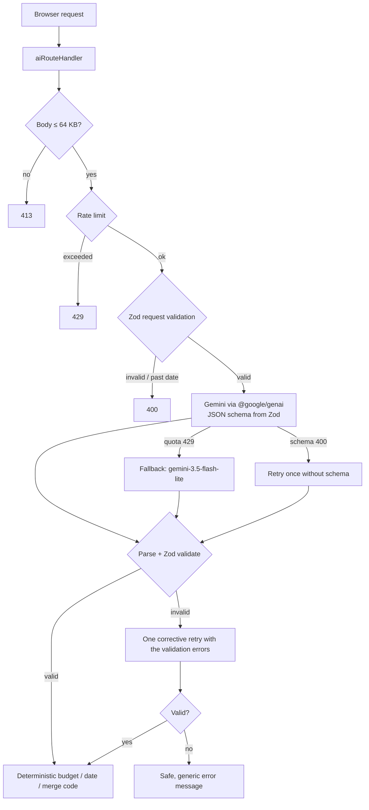

# Utsava — AI Celebration & Event Planner

[](https://github.com/SVG700/Utsava/actions/workflows/ci.yml)

> **PromptWars Virtual 2026 — Challenge 5: "Celebration & Event Planner"**
> _"Create a GenAI-powered planning assistant that helps users organize weddings, birthdays, and community events with budgets, timelines, vendor checklists, and personalized ideas."_

Utsava pairs **Google Gemini** (official `@google/genai` SDK, server-side only) with **deterministic TypeScript** for everything that must be exact — rupee budgets, due dates and merges. Gemini proposes; plain, tested code does the maths.

**Stack:** Next.js 16 (App Router) · React 19 · TypeScript (strict) · Tailwind CSS v4 · Zod · Vitest · Playwright

---

## Problem statement coverage

| Requirement | How Utsava delivers it | Key files |
| --- | --- | --- |
| **Weddings, birthdays, community events** | Three-step wizard with event type, Indian wedding sub-events (Haldi, Mehendi, Sangeet, Pheras, Reception), dietary needs, cultural traditions and accessibility needs. Past dates are rejected on client and server. | `src/components/EventWizard.tsx`, `src/components/wizard/`, `src/schemas/event.ts` |
| **GenAI plan** | Gemini returns a structured blueprint (theme, activities, budget split, timeline, vendor categories, risks, alternatives) validated against Zod schemas, personalised to city, guests, budget and traditions. | `src/app/api/generate-blueprint/route.ts`, `src/lib/ai/` |
| **Budgets** | AI percentages are normalised to exactly 100 % and converted to whole rupees that sum to the total. Expense ledger with edit/delete/undo, overspend alerts, editable total budget. | `src/lib/budget.ts`, `src/components/planner/BudgetTab.tsx` |
| **Timelines** | Milestones are stored as "days before the event"; due dates are computed in IST and shift automatically when the date changes. Filters, overdue warnings, completion tracking. | `src/lib/dates.ts`, `src/lib/timeline.ts`, `src/components/planner/TimelineTab.tsx` |
| **Vendor checklists** | AI suggests vendor categories and interview questions only — never business names or phone numbers. Each vendor links to a budget category so quotes are compared against targets. | `src/lib/vendors.ts`, `src/components/planner/VendorsTab.tsx` |
| **Personalised ideas** | Idea Studio generates themed ideas (theme, food, activities, decor, return gifts) that can be added to the timeline; refinement accepts natural-language requests such as "cut the total budget by 20%" or "make it eco-friendly". | `src/components/planner/IdeasTab.tsx`, `src/components/planner/RefineTab.tsx`, `src/lib/ai/mergePlan.ts` |
| **Keeping user work** | Regenerating or refining never duplicates items or loses user data: completed/user tasks and vendor quotes are fuzzy-merged into new AI suggestions; expenses are re-mapped to new categories. | `src/lib/planUpdates.ts` |
| **Export** | Budget, timeline and vendor CSVs (UTF-8 BOM, formula-injection safe) and a print-ready coordinator view. | `src/lib/planExports.ts`, `src/lib/csv.ts`, `src/components/planner/export/PrintablePlan.tsx` |

---

## Architecture

```
src/
├── app/                      # Next.js routes
│   ├── api/                  # Gemini endpoints (generate-blueprint, refine-plan, generate-ideas)
│   ├── events/[id]/          # Planner workspace
│   └── new/                  # Event creation wizard
├── components/
│   ├── landing/ wizard/      # Landing page and wizard steps
│   ├── planner/              # Planner tabs, one folder per tab for its sub-components
│   │   ├── header/  timeline/  budget/  vendors/  dashboard/  refine/  export/
│   └── ui/                   # Accessible primitives (Button, Input, Modal, UndoToast, …)
├── hooks/                    # usePlannerData, useBlueprintGeneration, useUndo
├── lib/
│   ├── ai/                   # Gemini integration (server-only)
│   │   ├── client.ts         #   public API: one function per use case
│   │   ├── gemini.ts         #   SDK transport: timeout, schema retry, quota fallback, 503 backoff
│   │   ├── structuredCall.ts #   parse → validate → corrective-retry pipeline
│   │   ├── geminiSchema.ts   #   Zod → Gemini response schema conversion
│   │   ├── prompts.ts        #   prompts with delimited user input
│   │   └── mergePlan.ts      #   applies refinements to a blueprint
│   ├── server/               # Shared API route pipeline (aiRouteHandler.ts)
│   ├── planUpdates.ts        # Pure state transitions: generate, refine, re-date, re-budget
│   ├── budget.ts dates.ts timeline.ts vendors.ts text.ts
│   ├── planExports.ts csv.ts # CSV exports
│   ├── storage.ts            # Validated localStorage persistence
│   ├── api.ts                # Typed browser → API client
│   ├── rateLimit.ts logger.ts utils.ts
└── schemas/                  # Zod schemas — single source of truth for types and validation
```

**Design rules**

- **AI suggests, code decides.** Gemini output is validated with Zod; all money, dates and merges are pure functions in `src/lib` with unit tests.
- **UI components hold no business logic.** Plan changes go through `planUpdates.ts`; persistence goes through `usePlannerData`'s single `commit()`, which also guarantees that slow AI responses are applied to the latest plan.
- **One pipeline per concern.** All three API routes share `createAiRouteHandler`; all three Gemini calls share `generateStructured`.

### GenAI request pipeline



- Response schemas are generated from Zod; keywords Gemini rejects (`minLength`, `maxItems`, …) are stripped and enforced afterwards by Zod instead.
- Free-text fields are truncated rather than rejected, so a verbose answer never fails a whole plan.
- A refinement must list `changedSections` and include them; otherwise the model gets one corrective retry, then the user sees "No changes could be applied" (HTTP 422).
- Requests time out after 45 s; the browser aborts in-flight requests when the user leaves the page.

---

## Security

- `GEMINI_API_KEY` is read only in server route handlers; it never reaches the client bundle or logs (log lines redact `key=` parameters).
- Clients receive generic error messages; upstream Gemini errors are logged server-side only.
- Every AI route enforces a 64 KB body limit, a per-client and global rate limit (`src/lib/rateLimit.ts`), and Zod validation.
- User text is wrapped in `<user_input>` tags and the system prompt instructs the model to treat it as data, never as instructions.
- AI output is rendered as React text nodes only (no `dangerouslySetInnerHTML`); data read back from `localStorage` is re-validated with Zod.
- CSV exports neutralise spreadsheet formula prefixes (`=`, `+`, `-`, `@`).
- Response headers (`next.config.ts`): Content-Security-Policy, Strict-Transport-Security, X-Frame-Options `DENY`, X-Content-Type-Options `nosniff`, Referrer-Policy, Permissions-Policy; `X-Powered-By` is disabled.

## Accessibility

- Planner tabs follow the WAI-ARIA tabs pattern (Arrow keys, Home, End).
- Dialogs move focus inside, trap Tab, close on Escape and restore focus.
- All form controls are labelled; validation errors are announced (`role="alert"`, `aria-invalid`).
- Light and dark themes; the saved theme is applied before first paint.
- Verified with `@axe-core/playwright` (no serious/critical violations in light or dark mode), keyboard-only E2E flow, and a 360 px viewport with no horizontal scrolling. Motion is reduced when the OS asks for it.

---

## Getting started

Requires Node.js 20.19+ (CI uses Node 22).

```bash
git clone https://github.com/SVG700/Utsava.git
cd Utsava
npm ci
cp .env.example .env.local   # then set GEMINI_API_KEY (https://aistudio.google.com/apikey)
npm run dev                  # http://localhost:3000
```

| Command | Purpose |
| --- | --- |
| `npm run dev` / `npm run build` / `npm start` | Develop, build, serve |
| `npm run lint` · `npm run typecheck` · `npm run format:check` | Static checks (all run in CI) |
| `npm test` | Unit and component tests (Vitest) |
| `npx vitest run --coverage` | Coverage report |
| `npm run test:e2e` | Playwright end-to-end tests (Gemini is mocked) |
| `node scripts/smoke-live.mjs` | Live check against real Gemini — run against `npm start`; exits non-zero on failure |

## Testing

- **Unit & component tests (Vitest, 220 tests):** budget maths, IST date logic, task/vendor merging, plan transitions, refinement resolution, CSV exports, schemas, storage validation, the Gemini client (retries, fallback, timeout, error sanitising), API routes, rate limiting, and the Modal, Budget, Ideas and Refine components. The test clock is pinned in `tests/setup.ts`, so date-based tests never expire.
- **End-to-end (Playwright, 7 tests):** create → generate → record expense → complete task → reload; mobile refinement; regenerate with preservation; keyboard-only wizard; 360 px layout; axe audit in light and dark mode; theme persistence.
- **Live smoke test:** asserts real Gemini output (all sections present, "cut the total budget by 20%" yields exactly 80 %, eco-friendly refinements change the theme, venue→catering reallocation moves the right percentages).

## Known limitations

- **Gemini free-tier quota:** daily limits apply; the app falls back to `gemini-3.5-flash-lite` and shows a clear message if both are exhausted.
- **In-memory rate limiting** resets on restart; a multi-instance deployment would use a shared store such as Redis.
- **Browser storage:** plans live in `localStorage` on one device; there is no account sync.
